<a href="https://www.victorstudios.org/en"></a>

<a href="https://www.victorstudios.org/en"><picture><source media="(prefers-color-scheme: dark)" srcset="assets/dark/l-site.svg"></picture></a>
<a href="https://www.framer.com/@vstd/"><picture><source media="(prefers-color-scheme: dark)" srcset="assets/dark/l-framer.svg"></picture></a>
<a href="https://contra.com/victorstudios"><picture><source media="(prefers-color-scheme: dark)" srcset="assets/dark/l-contra.svg"></picture></a>
<a href="https://www.fiverr.com/victorstudios"><picture><source media="(prefers-color-scheme: dark)" srcset="assets/dark/l-fiverr.svg"></picture></a>
<a href="https://x.com/vs_web3"><picture><source media="(prefers-color-scheme: dark)" srcset="assets/dark/l-x.svg"></picture></a>
<a href="https://www.youtube.com/@vic_std"><picture><source media="(prefers-color-scheme: dark)" srcset="assets/dark/l-youtube.svg"></picture></a>
<a href="https://www.instagram.com/vs_web3/"><picture><source media="(prefers-color-scheme: dark)" srcset="assets/dark/l-instagram.svg"></picture></a>
<a href="https://www.linkedin.com/in/72salman/"><picture><source media="(prefers-color-scheme: dark)" srcset="assets/dark/l-linkedin.svg"></picture></a>

<picture><source media="(prefers-color-scheme: dark)" srcset="assets/dark/now.svg"></picture>
  

<picture><source media="(prefers-color-scheme: dark)" srcset="assets/dark/s01.svg">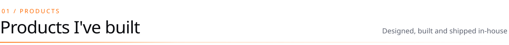</picture>

<a href="https://xoxi.me"><picture><source media="(prefers-color-scheme: dark)" srcset="assets/dark/p-xoxi.svg"></picture></a>
<a href="https://syvo.si"><picture><source media="(prefers-color-scheme: dark)" srcset="assets/dark/p-syvo.svg">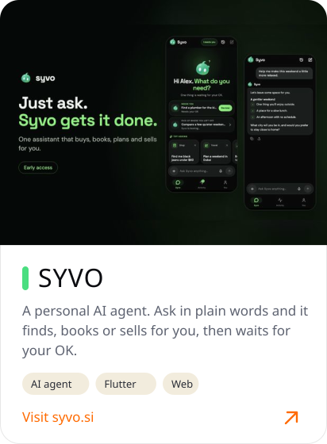</picture></a>
<a href="https://lovii.app"><picture><source media="(prefers-color-scheme: dark)" srcset="assets/dark/p-lovii.svg">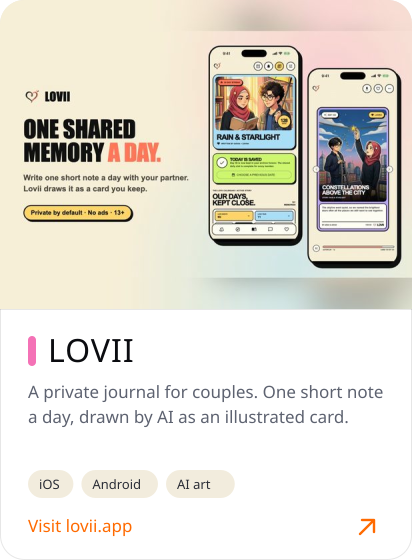</picture></a>

 

<picture><source media="(prefers-color-scheme: dark)" srcset="assets/dark/s02.svg"></picture>

<a href="https://www.fiverr.com/victorstudios/build-a-responsive-framer-website-with-scroll-animations"><picture><source media="(prefers-color-scheme: dark)" srcset="assets/dark/sv-framer.svg">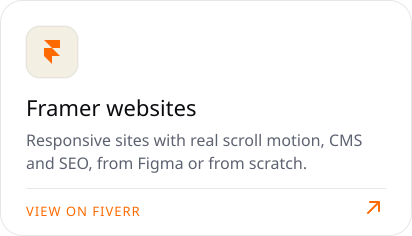</picture></a>
<a href="https://www.fiverr.com/victorstudios/build-ai-agents-chatbots-and-automations-for-your-business"><picture><source media="(prefers-color-scheme: dark)" srcset="assets/dark/sv-agents.svg">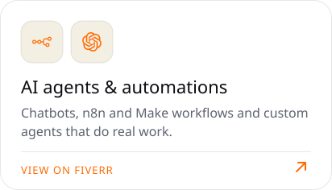</picture></a>
<a href="https://www.fiverr.com/victorstudios/do-full-ai-app-development-web-app-mobile-app-and-website"><picture><source media="(prefers-color-scheme: dark)" srcset="assets/dark/sv-aiapps.svg">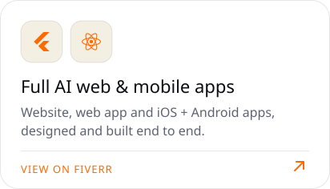</picture></a>

<a href="https://www.fiverr.com/victorstudios/design-modern-app-and-web-ui-ux"><picture><source media="(prefers-color-scheme: dark)" srcset="assets/dark/sv-uiux.svg">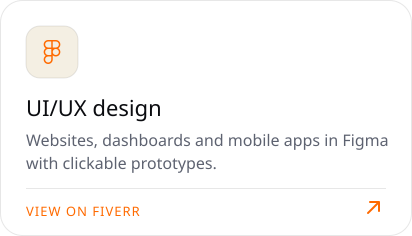</picture></a>
<a href="https://www.fiverr.com/victorstudios/build-wordpress-website-shopify-store-or-woocommerce-store"><picture><source media="(prefers-color-scheme: dark)" srcset="assets/dark/sv-wpshop.svg">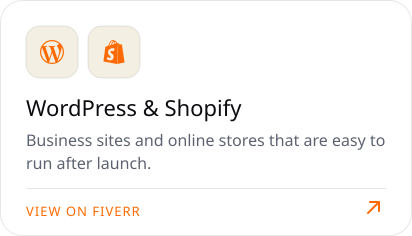</picture></a>
<a href="https://www.fiverr.com/victorstudios/design-nft-marketplace-website-design"><picture><source media="(prefers-color-scheme: dark)" srcset="assets/dark/sv-nftweb.svg">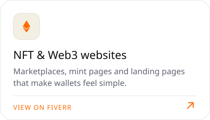</picture></a>

<a href="https://www.fiverr.com/victorstudios/develop-dapps-nft-mint-on-ethereum-polygon-solana"><picture><source media="(prefers-color-scheme: dark)" srcset="assets/dark/sv-dapp.svg">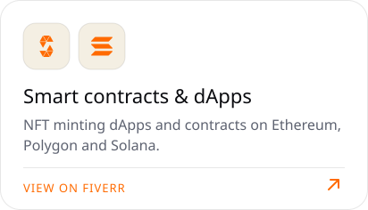</picture></a>
<a href="https://www.fiverr.com/victorstudios/create-web3-crypto-website-for-your-meme-coin"><picture><source media="(prefers-color-scheme: dark)" srcset="assets/dark/sv-memecoin.svg">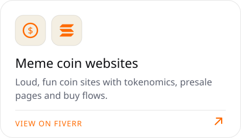</picture></a>
<a href="https://www.fiverr.com/victorstudios/create-a-modern-minimalist-logo-for-nfts"><picture><source media="(prefers-color-scheme: dark)" srcset="assets/dark/sv-brand.svg">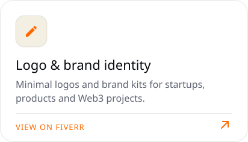</picture></a>

 

<picture><source media="(prefers-color-scheme: dark)" srcset="assets/dark/s03.svg"></picture>

<a href="https://www.behance.net/gallery/232965655/Medelz-Music-Streaming-Artist-Discovery-Platform"><picture><source media="(prefers-color-scheme: dark)" srcset="assets/dark/w-medelz.svg">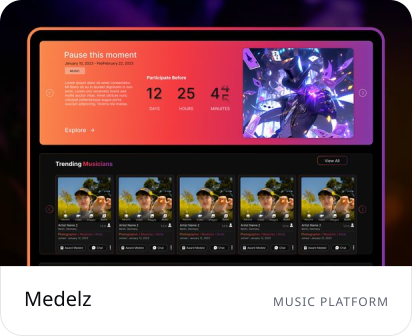</picture></a>
<a href="https://www.behance.net/gallery/232893223/Smart-Forum-Technology-Services-Website"><picture><source media="(prefers-color-scheme: dark)" srcset="assets/dark/w-smartforum.svg">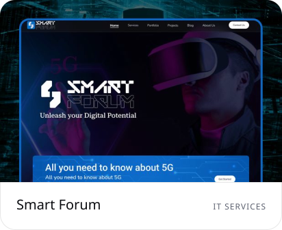</picture></a>
<a href="https://www.behance.net/gallery/232892185/SatHoller-NFT-Auction-Bidding-Platform"><picture><source media="(prefers-color-scheme: dark)" srcset="assets/dark/w-satholler.svg">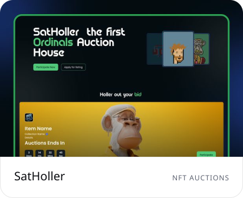</picture></a>

<a href="https://www.behance.net/gallery/232883891/MetaAdsFirm-Web3-Metaverse-Smart-Contract-Solutions"><picture><source media="(prefers-color-scheme: dark)" srcset="assets/dark/w-metaadsfirm.svg">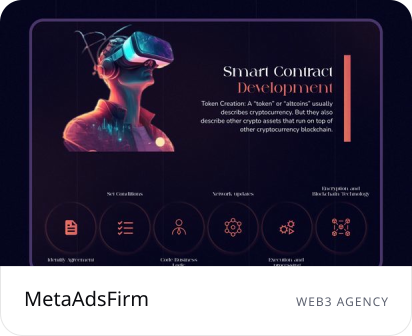</picture></a>
<a href="https://www.behance.net/gallery/232881881/The-Black-Momento"><picture><source media="(prefers-color-scheme: dark)" srcset="assets/dark/w-blackmomento.svg">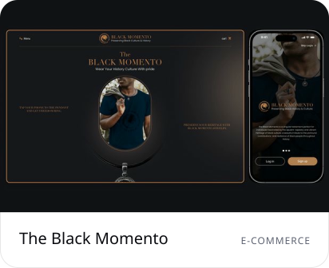</picture></a>
<a href="https://www.behance.net/gallery/232882337/Blckbuster-Digital-Marketplace-for-Movie-Rights"><picture><source media="(prefers-color-scheme: dark)" srcset="assets/dark/w-blckbuster.svg">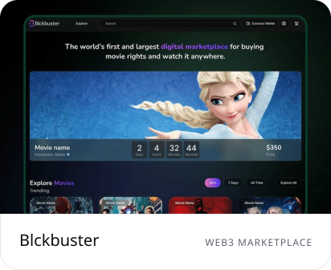</picture></a>

 

<picture><source media="(prefers-color-scheme: dark)" srcset="assets/dark/s04.svg"></picture>

<picture><source media="(prefers-color-scheme: dark)" srcset="assets/dark/stack.svg"></picture>
  

<picture><source media="(prefers-color-scheme: dark)" srcset="assets/dark/s05.svg">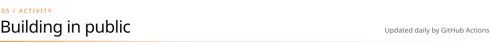</picture>

<picture><source media="(prefers-color-scheme: dark)" srcset="https://raw.githubusercontent.com/victor-studios/victor-studios/output/snake-dark.svg"></picture>
  

<a href="https://www.victorstudios.org/en"></a>

<!-- Graphics are generated by tools/build.py in the Victor Studios palette. -->
